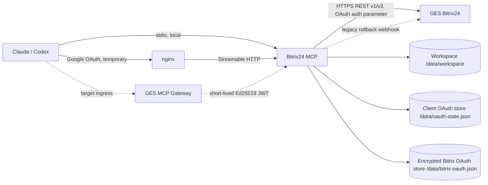

# Bitrix24 MCP Server

A [Model Context Protocol (MCP)](https://modelcontextprotocol.io) server that connects **Claude** to your **Bitrix24** portal via OAuth 2.0 or a legacy incoming webhook.

Once configured, Claude can read and write CRM records, manage tasks, browse your disk, send notifications, query the product catalog, run business processes, and much more — all from natural conversation.

Built and maintained by **[Bit2Beat](https://bit2beat.com)** — Bitrix24 specialists.

---

## Features

| Area | What Claude can do |
|---|---|
| **CRM** | List, get, create, update, and delete deals, contacts, companies, leads, and Smart Process items. Add timeline comments. |
| **Tasks** | List, get, create, update, and complete tasks. |
| **Task Templates** | Create, list, and update native Bitrix24 task templates, and spawn tasks from them with checklists, tags, CRM bindings, and user fields. |
| **Task User Fields** | List, create, update, and delete custom fields on tasks. |
| **Users & Departments** | List active users and the organizational structure. |
| **Disk** | Browse storages and folders, get file info and download links, upload files. |
| **Calendar** | List and create calendar events. |
| **Chat & Notifications** | Send private messages and personal notifications. |
| **Live Feed** | Post messages to the activity feed. |
| **Groups** | List workgroups and projects. |
| **Business Processes** | List active workflows and start new ones. |
| **Telephony** | Query the call history log. |
| **Mail** | List mailboxes, list and read email messages, and follow email threads (REST v3 — requires the `mail` scope). |
| **Knowledge Base** | Browse knowledge bases and their articles, read article content, create and publish articles, and edit their blocks, cards, and images (requires the `landing` scope). |
| **Knowledge Base 2.0** | Create knowledge bases, browse their document tree, read and write articles as Markdown, search across documents, and attach files (REST v3 — requires the `note` scope). |
| **Product Catalog** | List, get, create, and update products and sections. |
| **Configuration** | Export the full portal config (pipelines, stages, custom fields, automations) to JSON, compare two configs, and apply one config to another portal. |
| **Raw API** | Call any Bitrix24 REST method directly, including batch requests. |

---

## Requirements

- [Node.js](https://nodejs.org) **24.20.0 LTS**
- [Claude Desktop](https://claude.ai/download) or [Claude Code](https://claude.ai/code)
- A Bitrix24 local API-only application (OAuth, recommended for remote use) or an incoming webhook URL (legacy/rollback)

---

## Installation

### 1. Clone the repository

```bash
git clone https://github.com/managerges07-lgtm/bitrix24-mcp.git
cd bitrix24-mcp
```

### 2. Install dependencies

```bash
npm ci
```

### 3A. Create your Bitrix24 webhook (legacy/rollback)

> **Administrator required.** Only a Bitrix24 portal administrator can create incoming webhooks. This is a platform security restriction — webhooks act as system-level credentials and can carry broader permissions than a regular user session.

#### Step-by-step

1. Log in to your Bitrix24 portal as an **administrator**
2. Go to **Applications** (left sidebar) → **Webhooks**
3. Click **Incoming webhooks** → **Add webhook**
4. Give it a descriptive name (e.g. `Claude MCP`)
5. Under **Permissions**, enable the scopes you need (see [Access Profiles](#access-profiles) below)
6. Click **Save**
7. Copy the generated URL — it looks like:
   ```
   https://your-portal.bitrix24.com/rest/1/abc123xyz/
   ```
   This URL is your `B24_DEFAULT_WEBHOOK`. **Keep it private** — it grants API access to your portal.

#### Where to find it later

If you need to edit the webhook or add more scopes after the initial setup:

**Applications → Webhooks → Incoming webhooks → (click your webhook name)**

### 3B. Configure outgoing Bitrix24 OAuth (recommended for remote use)

Create a local server-side application in Bitrix24 with **Uses API only** enabled.
The application runs as the employee who installs it, so use the approved
technical user and select only the required scopes. The initial installation
path is:

```text
<B24_PUBLIC_URL>/bitrix/oauth/install
```

Set `B24_BITRIX_AUTH_MODE=oauth` and the `B24_BITRIX_*` variables documented in
[the OAuth migration runbook](docs/BITRIX_OAUTH.md). Access and rotating refresh
tokens are stored in an encrypted persistent file. The client refreshes the pair
only after Bitrix24 returns `expired_token` and then retries the original call
once. In OAuth mode all tools share this application identity, including
`b24_kb2_*`; per-call `webhook_url` overrides are disabled.

### 4. Configure Claude Desktop

Open your Claude Desktop configuration file:

| OS | Path |
|---|---|
| Windows | `%APPDATA%\Claude\claude_desktop_config.json` |
| macOS | `~/Library/Application Support/Claude/claude_desktop_config.json` |

Add the following entry inside `"mcpServers"`:

```json
{
  "mcpServers": {
    "bitrix24": {
      "command": "node",
      "args": ["C:/full/path/to/bitrix24-mcp/index.js"],
      "env": {
        "B24_DEFAULT_WEBHOOK": "https://your-portal.bitrix24.com/rest/1/your-token/"
      }
    }
  }
}
```

> **Windows note:** use forward slashes (`/`) or escaped backslashes (`\\`) in the path.

> **Knowledge Base 2.0:** the `b24_kb2_*` tools need the `note` scope. If it lives on a
> different webhook than the one above — which is common, since `note` can only be granted
> by hand in the Bitrix24 UI — add `B24_NOTE_WEBHOOK` next to `B24_DEFAULT_WEBHOOK`. That
> webhook also decides authorship: documents are created by the user it belongs to.

### 5. Restart Claude Desktop

After saving the config file, restart Claude Desktop. You should see the Bitrix24 tools available in the tools panel.

---

## Remote server (HTTP + Google OAuth)

The steps above run the server locally over **stdio**. You can also run it as a
**remote MCP server** behind HTTPS and connect it from Claude as a *custom
connector*, gated by **Google OAuth + an email allowlist**.

In this mode the server acts as an OAuth Authorization Server for Claude and uses
Google to authenticate the real user; only emails listed in `B24_ALLOWED_EMAILS`
are admitted. All admitted users share the configured server-side Bitrix24
identity: the local OAuth application in OAuth mode or `B24_DEFAULT_WEBHOOK` in
legacy mode.

Set `B24_TRANSPORT=http` plus `B24_PUBLIC_URL`, `B24_GOOGLE_CLIENT_ID`,
`B24_GOOGLE_CLIENT_SECRET` and `B24_ALLOWED_EMAILS` (see `.env.example`). The
target deployment is Docker + nginx on a VPS, one subdomain per MCP server.

In webhook mode, overrides are limited to the exact hosts configured by
`B24_DEFAULT_WEBHOOK`, `B24_NOTE_WEBHOOK` or `B24_ALLOWED_WEBHOOK_HOSTS`. File-based
configuration tools are confined to `B24_WORKSPACE_DIR`. Destructive tools and
destructive methods passed through `b24_call`/`b24_batch` require `confirm: true`.

➡️ Full instructions: [`deploy/DEPLOY.md`](deploy/DEPLOY.md).

---

## Access Profiles

Bitrix24 webhooks use **scopes** to control which modules are accessible. Each scope unlocks a set of API methods — but within a scope, all operations (read and write) are permitted. There is no built-in "read-only" flag at the scope level.

The practical way to limit what Claude can do is to combine the right set of scopes. Below are three ready-made profiles that cover the most common use cases.

---

### Profile 1 — Structure Inspector (no business data)

Use this when you want Claude to understand the portal's configuration — pipelines, stages, custom fields, automations — **without access to any actual records** (no deals, no contacts, no tasks).

> Ideal for: consultants auditing a portal setup, or developers mapping the CRM before building an integration.

**Scopes to enable:**

| Scope | What it unlocks |
|---|---|
| `user` | Read user list (needed to resolve assignee names) |
| `department` | Read department structure |
| `bizproc` | Read automation rules and business processes |
| `catalog` | Read product catalog structure |

**What Claude can do:** `b24_read_full_config`, `b24_read_pipelines`, `b24_read_custom_fields`, `b24_read_entity_types`, `b24_read_automations`, `b24_read_product_catalog`, `b24_compare_configs`, `b24_users_list`, `b24_departments_list`

**What Claude cannot do:** read or write deals, contacts, tasks, disk files, chat, or calendar.

> **Note:** Pipeline and custom field data is accessed through the `crm` module internally. If you also want to inspect CRM structure (stages, field names), add `crm` to this profile — but be aware that this also enables read access to CRM records.

---

### Profile 2 — Read-Only Operations

Use this when you want Claude to read business data but not create or modify anything.

> Ideal for: reporting, analysis, answering questions about pipeline status or task progress.

**Important caveat:** Bitrix24 scopes do not distinguish between read and write at the API level. The `crm` scope enables both `crm.deal.list` (read) and `crm.deal.add` (write). **Scopes alone cannot enforce read-only access.**

To achieve a true read-only profile you have two options:

- **Trust-based:** Enable only the scopes below and instruct Claude not to modify data. Claude will follow the instruction, but there is no technical enforcement.
- **Enforcement-based:** Run a separate instance of this MCP server that only registers read tools. This requires a small code change and is planned as a future feature (`B24_PROFILE=readonly`).

**Recommended scopes for a read-leaning profile:**

| Scope | What it unlocks |
|---|---|
| `crm` | Read (and write) CRM records |
| `task` | Read (and write) tasks |
| `user` | Read users |
| `department` | Read departments |
| `catalog` | Read product catalog |
| `bizproc` | Read automations |
| `telephony` | Read call history |

---

### Profile 3 — Full Access

Use this when you want Claude to operate as a full Bitrix24 assistant — reading, writing, sending messages, managing files, and everything in between.

**All scopes:**

| Scope | Enables |
|---|---|
| `crm` | CRM records (deals, contacts, companies, leads, SPAs) |
| `task` | Tasks |
| `user` | Users |
| `department` | Departments |
| `disk` | Disk / file storage |
| `calendar` | Calendar events |
| `im` | Chat messages and notifications |
| `bizproc` | Business processes and automations |
| `catalog` | Product catalog |
| `telephony` | Call history |
| `mail` | Read mailboxes and email messages (REST v3) |
| `note` | Knowledge Base 2.0: bases, documents, files (REST v3) |

> Claude will gracefully report when a requested action requires a scope that is not enabled on the webhook, so you can always start with fewer scopes and add more later.

---

## Available Tools

<details>
<summary>Click to expand full tool list (77 tools)</summary>

### Connection
- `b24_test_connection` — Verify the webhook and confirm portal info and user permissions.

### CRM
- `b24_crm_list` — List CRM records with filters and automatic pagination.
- `b24_crm_get` — Get a single CRM record by ID.
- `b24_crm_create` — Create a new CRM record.
- `b24_crm_update` — Update an existing CRM record.
- `b24_crm_delete` — Delete a CRM record.
- `b24_crm_fields` — List all available fields for an entity (standard + custom).
- `b24_crm_timeline_add` — Add a comment or activity to a CRM record's timeline.

### Tasks
- `b24_tasks_list` — List tasks with filters.
- `b24_tasks_get` — Get full task detail.
- `b24_tasks_create` — Create a new task.
- `b24_tasks_update` — Update an existing task.
- `b24_tasks_complete` — Mark a task as complete.

### Task Templates
- `b24_task_template_create` — Create a native Bitrix24 task template (title, description, assignee, creator, co-workers, observers, priority, deadline offset, checklist, tags, CRM bindings, user fields, recurrence). Refuses to create a same-named duplicate and re-reads the result.
- `b24_task_template_list` — List templates with filters by title, assignee, creator, project, and recurrence.
- `b24_task_template_update` — Update a template; tags and the checklist are replaced wholesale.
- `b24_task_create_from_template` — Spawn a task from a template, turning deadline offsets into dates and copying the checklist, tags, CRM bindings, and user fields. Any field can be overridden.

> **Portal quirks these tools work around.** `tasks.template.list` is broken in the Bitrix24 cloud
> (it answers `Unknown field definition "filter"` for every argument set), so the list is assembled by
> scanning IDs through `batch` — raise `max_id` if the portal holds many templates. A template's `TAGS`
> and `XML_ID` fields are silently dropped by REST, so tags are kept as a `[MCP_TAGS]: …` marker line at
> the end of the description and turned into real tags on the task. Task templates also have **their own**
> user-field entity (`TASKS_TASK_TEMPLATE`), separate from tasks — see below.

### Task User Fields
- `b24_task_userfield_list` — List custom fields on tasks; optionally the type catalogue and the separate template field set.
- `b24_task_userfield_create` — Create a custom field on tasks (the `UF_` prefix is added automatically).
- `b24_task_userfield_update` — Change label, sort order, mandatory flag, settings, or list values.
- `b24_task_userfield_delete` — Delete a field. Requires `confirm: true` — its values are erased in **all** tasks.

> **Tasks and task templates do not share user fields.** A field created here belongs to `TASKS_TASK`;
> templates use `TASKS_TASK_TEMPLATE`, and Bitrix24 exposes no REST method to create a field there — it
> has to be done in the portal UI. Passing a code to the wrong entity is rejected with an explicit error
> instead of being silently discarded.

### Users & Departments
- `b24_users_list` — List active users.
- `b24_departments_list` — List departments with hierarchy.

### Disk
- `b24_disk_storages` — List available storages.
- `b24_disk_folder_list` — Browse a folder's contents.
- `b24_disk_file_get` — Get file info and download URL.
- `b24_disk_file_upload` — Upload a file to a folder.

### Calendar
- `b24_calendar_list` — List calendar events.
- `b24_calendar_create` — Create a calendar event.

### Communication
- `b24_chat_send` — Send a private or group chat message.
- `b24_notify_send` — Send a personal notification.
- `b24_feed_post` — Post to the Live Feed.
- `b24_groups_list` — List workgroups and projects.

### Business Processes
- `b24_bizproc_list` — List active workflow instances.
- `b24_bizproc_start` — Start a business process on a record.

### Telephony
- `b24_telephony_calls` — Query the call history log.

### Mail (read)
> Uses the Bitrix24 **REST v3** mail API (served from the `/rest/api/` base path). Requires the **`mail`** scope on the webhook — this is separate from `mailservice` — and a commercial plan.
- `b24_mail_mailbox_list` — List the webhook user's mailboxes (id, name, email, sender name).
- `b24_mail_message_list` — List a mailbox's messages, filtered by text, date range, read/unread, attachments, or folder.
- `b24_mail_message_get` — Get a full message by ID, including its body.
- `b24_mail_message_thread` — Get the email thread (conversation) for a given message ID.

### Knowledge Base
> A knowledge base is a `landing` site of type `KNOWLEDGE`, its articles are pages, and article content is made of layout blocks. Requires the **`landing`** scope on the webhook and a commercial plan. Every call sends `scope: "KNOWLEDGE"` for you — without it Bitrix24 silently returns other sites or `LANDING_NOT_EXIST`. Block edits land in the page **draft**: publish the page to make them visible.
- `b24_kb_list` — List the portal's knowledge bases.
- `b24_kb_pages` — List a knowledge base's articles, with public URLs.
- `b24_kb_page_get` — Read an article block by block: plain text, editable node map with ready-made selectors, or raw HTML.
- `b24_kb_page_create` — Create an article (created empty and unpublished).
- `b24_kb_page_publish` — Publish an article, pushing the draft live.
- `b24_kb_block_add` — Add a layout block (heading, text, FAQ, columns) to an article.
- `b24_kb_block_update` — Set a block's texts, images, and links by node selector.
- `b24_kb_block_delete` — Delete a block from an article.
- `b24_kb_card_add` — Add or clone a card inside a block (FAQ item, column, list entry).
- `b24_kb_card_remove` — Remove a card from a block by indexed selector.
- `b24_kb_image_upload` — Upload an image and bind it to a block, returning its `src`.

### Knowledge Base 2.0

A separate engine from the `b24_kb_*` tools above: a base holds a tree of documents whose
content is plain Markdown, and there is no publishing step. Needs the `note` scope, which is
usually granted to a personal webhook — see `B24_NOTE_WEBHOOK` in `.env.example`.

- `b24_kb2_list` — List the portal's Knowledge Base 2.0 bases.
- `b24_kb2_create` — Create a base.
- `b24_kb2_delete` — Delete a base and all of its documents (requires `confirm: true`).
- `b24_kb2_tree` — List a base's document tree with article links.
- `b24_kb2_page_get` — Read a document: title plus its full Markdown.
- `b24_kb2_page_create` — Create a document, optionally nested under a parent.
- `b24_kb2_page_update` — Replace a document's title and/or Markdown.
- `b24_kb2_page_delete` — Delete a document (cascades to nested ones).
- `b24_kb2_search` — Search documents by title and body across all bases.
- `b24_kb2_file_add` — Attach an image or file and get the `[[image fileId=…]]` block to embed.

### Product Catalog
- `b24_products_list` — List catalog products.
- `b24_products_get` — Get product detail.
- `b24_products_create` — Create a product.
- `b24_products_update` — Update a product.
- `b24_products_sections` — List catalog sections.

### Configuration Management
- `b24_read_full_config` — Export the complete portal configuration to JSON.
- `b24_read_entity_types` — Read CRM and SPA entity types.
- `b24_read_pipelines` — Read pipelines and their stages.
- `b24_read_custom_fields` — Read custom fields across all CRM entities.
- `b24_read_automations` — Read automation rules by stage.
- `b24_read_product_catalog` — Read the product catalog structure.
- `b24_compare_configs` — Compare two portal config JSON files.
- `b24_apply_config` — Apply an exported config to a target portal.
- `b24_save_user_mapping` — Generate a user ID mapping between two portals.

### Raw API
- `b24_call` — Call any Bitrix24 REST API method directly.
- `b24_batch` — Execute multiple API calls in a single HTTP request.

</details>

---

## Usage Examples

Once configured, you can ask Claude things like:

> *"Show me all open deals assigned to María"*

> *"Create a task for Tadeo to review the contract, due Friday"*

> *"What calls came in from company X this week?"*

> *"Export the full CRM configuration of this portal to JSON"*

> *"Compare this portal's pipeline config with the one in config_backup.json"*

---

## Architecture



The HTTP client enforces a **500 ms minimum delay** between requests to respect Bitrix24's rate limits, and retries automatically on `429 Too Many Requests` and timeout errors (up to 3 retries with exponential backoff).

---

## Configuration Migration

This server includes tools designed for Bitrix24 consultants and partners who need to replicate portal configurations across multiple instances:

1. **Export** the source portal config with `b24_read_full_config`
2. **Compare** it against the target with `b24_compare_configs`
3. **Apply** it to the target with `b24_apply_config` and `confirm: true`

This workflow covers pipelines, stages, custom fields, currencies, SPA types, automations, and the product catalog.
All referenced JSON files must be inside `B24_WORKSPACE_DIR`.

---

## Tests

```bash
npm test        # unit tests + a real tools/list handshake over stdio — no network
npm run test:live   # additionally runs end-to-end against the portal
```

`npm test` checks the pure helpers (PHP-serialized field parsing, tag markers, CRM code building,
template normalization) and then boots the server over stdio and asserts that `tools/list` exposes the
expected tools and that none of the existing ones disappeared.

`npm run test:live` needs a configured Bitrix24 webhook or OAuth store. It creates a temporary task user field, a template and
tasks named `[MCP TEST] …` on the portal, verifies tags, CRM bindings, user fields, checklists,
duplicate protection and input validation, then **deletes everything it created**. Override the actors
with `B24_TEST_USER_ID` and `B24_TEST_DEAL_ID`.

---

## Contributing

Contributions are welcome. Please open an issue first to discuss what you would like to change.

1. Fork the repository
2. Create a feature branch (`git checkout -b feature/your-feature`)
3. Commit your changes
4. Open a pull request

---

## License

[MIT](LICENSE)

---

## About Bit2Beat

[Bit2Beat](https://bit2beat.com) is a Bitrix24 specialist firm. We build integrations, automations, and AI-powered tools on top of the Bitrix24 platform.

If you need help implementing this MCP server or building custom Bitrix24 integrations, feel free to reach out at [info@bit2beat.com](mailto:info@bit2beat.com).


## TaskCreator integration (local candidate, disabled by default)

Optional `b24_taskcreator_*` tools call the GES Assistant API with a separate
60-second Ed25519 JWT. Set `B24_TASKCREATOR_ENABLED`, `B24_TASKCREATOR_BASE_URL`
and `B24_TASKCREATOR_PRIVATE_KEY_FILE` only after outgoing Bitrix OAuth is ready.
The Assistant technical account must match the MCP application account; OAuth
token stores remain independent. Public APIs outside TaskCreator are not exposed.

Tools: schema/list/get/validate, create_draft/save_draft/publish/rollback/delete,
context/preview/create. All require `deal_id`; publish/rollback/delete/create also
require explicit `confirm=true`. Delete retains template history and existing tasks.
No integration HTTP request is retried automatically. Test with `npm test`;
read-only deployment smoke: `node scripts/taskcreator-smoke.mjs <deal_id>`.
The canonical two-stage release runbook is
`ges-operations/runbooks/taskcreator-mcp-oauth-release.md` in the workspace.
