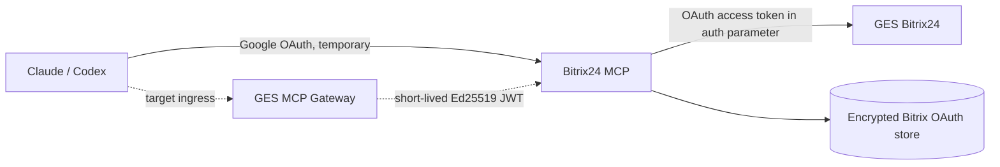

# Bitrix24 OAuth migration

This runbook replaces the outgoing Bitrix24 webhook credential used by the MCP
with OAuth 2.0 from a local server-side application. It does not change the
Google OAuth or Gateway authentication used between the MCP client and server.

## Target flow



The application runs in the identity of the employee who installs it. Use a
dedicated technical Bitrix24 user with the intended permissions and authorship.

## Security model

- The OAuth client secret and the independent 32-byte storage-encryption key
  remain in the runtime `.env`; never put their values in Git or logs.
- `access_token`, rotating `refresh_token`, `application_token`, and `member_id`
  are stored together in an AES-256-GCM envelope.
- The installation callback accepts only `ONAPPINSTALL`, requires the configured
  portal host, and validates the supplied access token through `profile` before
  saving it. A repeated callback must also match the stored application identity.
- REST tokens are sent in the `auth` request parameter, never in the URL path.
- On `expired_token`, concurrent calls share one refresh operation; the newly
  returned access and refresh tokens replace the old pair atomically.
- Per-tool `webhook_url` overrides are rejected in OAuth mode.

## Required metadata and credentials

Configure these names without printing their values:

```dotenv
B24_BITRIX_PORTAL_HOST=your-portal.bitrix24.com
B24_BITRIX_CLIENT_ID=<local application client id>
B24_BITRIX_CLIENT_SECRET=<local application client secret>
B24_BITRIX_OAUTH_TOKEN_URL=https://oauth.bitrix24.tech/oauth/token/
B24_BITRIX_TOKEN_STORE_PATH=/data/bitrix-oauth.json
B24_BITRIX_TOKEN_ENCRYPTION_KEY=<32-byte unpadded base64url value>
```

Use the regional OAuth token endpoint returned by Bitrix24 rather than assuming
the example host for every portal. Generate a new encryption key separately; do
not derive it from or reuse the OAuth client secret.

## Staged cutover

Production actions in this section require separate approval.

1. Deploy the OAuth-capable code while keeping
   `B24_BITRIX_AUTH_MODE=webhook`. Preserve the current source and image as the
   rollback artifacts.
2. Add the OAuth variables and set
   `B24_BITRIX_OAUTH_INSTALL_ENABLED=true`. Recreate only the Bitrix24 MCP
   container and verify its health; existing tool traffic still uses webhooks.
3. In Bitrix24, create a local server-side application, enable **Uses API only**,
   select the required scopes, and set the initial installation path to:

   ```text
   https://btrx-mcp.texpertiza.ru/bitrix/oauth/install
   ```

4. Install the application as the selected technical user. Confirm only that
   the encrypted store file exists and is non-empty; do not display it.
5. Run the read-only OAuth smoke inside the candidate container:

   ```bash
   npm run smoke:bitrix-oauth
   ```

   It calls only `app.info` and `profile` and prints no token or client secret.
6. Compare the returned user identity and application status with the approved
   baseline. Confirm that the granted scopes cover every currently used tool,
   including `note` if Knowledge Base 2.0 is required.
7. Set `B24_BITRIX_AUTH_MODE=oauth` and
   `B24_BITRIX_OAUTH_INSTALL_ENABLED=false`, then recreate only this container.
8. Verify health, MCP initialization, `b24_test_connection`, and a representative
   read-only call. Any write smoke must use a designated technical object and
   requires separate approval.
9. Keep both webhook credentials active as rollback during the observation
   window. Revoke them only after an explicit decision backed by successful
   natural traffic and token refresh evidence.

## Rollback

Set `B24_BITRIX_AUTH_MODE=webhook`, restore the previous image if required, and
recreate only the Bitrix24 MCP container. Do not delete the encrypted OAuth store
or revoke the local application during rollback; retain both for diagnosis until
the migration is accepted or explicitly abandoned.

## Failure interpretation

- `Bitrix24 OAuth is not installed` — the callback did not populate the store or
  the configured store path points elsewhere.
- `Cannot decrypt or authenticate` — the encryption key changed, the file is
  corrupted, or the wrong volume is mounted. Do not overwrite the file.
- `expired_token` followed by successful retry — normal on-demand refresh.
- `invalid_grant` during refresh — the refresh token expired, was invalidated, or
  the application was removed; preserve evidence and reinstall deliberately.
- Installation identity mismatch — a callback belongs to another application or
  portal identity. Do not replace the store automatically.

## Official references

- [Complete OAuth 2.0 protocol](https://apidocs.bitrix24.com/settings/oauth/index.html)
- [Local application installation callback](https://apidocs.bitrix24.com/settings/app-installation/local-apps/installation-callback.html)
- [Server-side local application without a UI](https://apidocs.bitrix24.com/local-integrations/serverside-local-app-with-no-ui.html)
- [Refresh after `expired_token`](https://apidocs.bitrix24.com/api-reference/chat-bots/send-command.html)


## 2026-09-24 candidate hardening

Installation accepts JSON and nested form-urlencoded auth. The verified profile
ID is retained as `userId`; callbacks and refresh must preserve it. Installation
and refresh writes are serialized in-process, and refresh remains single-flight.
Transport retries are allowed only for explicitly recognized read methods;
unknown methods and writes are never retried on timeout or HTTP 429. The one
retry following an explicit expired_token rejection remains enabled.
TaskCreator integration is a subsequent release and uses its own Ed25519 key,
not the Bitrix OAuth tokens. Production cutover and live checks remain pending.
